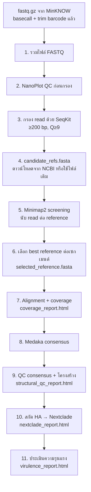

# Chim-influenza-nanopore-pipeline
Automated Influenza A  Nanopore analysis pipeline for WSL2: FASTQ → consensus → clade → virulence markers
# h5n1-nanopore-pipeline

###########################################################################################
พัฒนาโดย 
นายชัยณรงค์ กุลฉิม นักวิทยาศาสตร์การแพทย์ชำนาญการ ศูนย์วิจัยและพัฒนาการสัตวแพทย์ภาคเหนือตอนล่าง
จ.พิษณุโลก 080-5040716 email: chainarong681@gmail.com
###########################################################################################


Automated **Influenza A (H5N1)** Nanopore analysis pipeline for **Windows + WSL2 (Ubuntu)**:
from MinKNOW `*.fastq.gz` → QC → best-reference selection → alignment/coverage → Medaka consensus → Nextclade clade → virulence/resistance markers, with HTML reports at every key step.

> ไปป์ไลน์วิเคราะห์ผล Nanopore ของไวรัสไข้หวัดใหญ่ A (H5NX) แบบอัตโนมัติ รันคำสั่งเดียวจบ ผ่าน WSL2 บน Windows
> พัฒนาจาก SOP วิเคราะห์ผล Nanopore ของห้องปฏิบัติการไวรัสวิทยา ศวพ.พิษณุโลก

---

## สารบัญ

- [ภาพรวม](#ภาพรวม)
- [ความต้องการของระบบ](#ความต้องการของระบบ)
- [การติดตั้ง](#การติดตั้ง)
- [วิธีใช้งาน](#วิธีใช้งาน)
- [ตัวเลือกคำสั่ง](#ตัวเลือกคำสั่ง)
- [ขั้นตอนที่ไปป์ไลน์ทำ](#ขั้นตอนที่ไปป์ไลน์ทำ)
- [ไฟล์ผลลัพธ์](#ไฟล์ผลลัพธ์)
- [การแก้ปัญหาที่พบบ่อย](#การแก้ปัญหาที่พบบ่อย)
- [ข้อจำกัดและข้อควรระวัง](#ข้อจำกัดและข้อควรระวัง)
- [โครงสร้างไฟล์](#โครงสร้างไฟล์)

---

## ภาพรวม



จุดเด่น:

- รันครั้งเดียวจบ ทั้งจาก CMD/PowerShell (`run_flu.bat`) และจากหน้าต่าง Ubuntu (`flu_pipeline.sh`)
- ติดตั้ง Miniconda, environment และเครื่องมือทั้งหมดให้อัตโนมัติ (`-s`)
- **เลือก reference ที่ดีที่สุดให้อัตโนมัติ** ต่อเซกเมนต์ จากจำนวน read ที่แมพ (นับเฉพาะ primary alignment) เหมาะกับเชื้อกลายพันธุ์สูงหรือยังไม่ทราบสายพันธุ์
- รันซ้ำได้: ข้ามขั้นตอนที่มีไฟล์ผลลัพธ์แล้ว (ใช้ `-f` เพื่อบังคับรันใหม่)
- สร้างรายงาน HTML ทุกขั้นตอนสำคัญ และบันทึก log ที่ `pipeline.log`

## ความต้องการของระบบ

| รายการ | รายละเอียด |
|---|---|
| ระบบปฏิบัติการ | Windows 10/11 พร้อม WSL2 + Ubuntu |
| อินเทอร์เน็ต | ต้องใช้ตอนติดตั้ง, ดาวน์โหลด candidate refs จาก NCBI และ Nextclade dataset |
| ข้อมูลนำเข้า | `*.fastq.gz` จาก MinKNOW (basecall และ trim barcode แล้ว) แยกโฟลเดอร์ต่อ barcode |
| RAM / CPU | ยิ่งมากยิ่งเร็ว ขั้น Medaka ใช้เวลามากที่สุด (ใช้ `-t` จำกัด thread ได้) |

เครื่องมือที่สคริปต์ติดตั้งให้ใน conda env `flu_analysis`: minimap2, samtools, medaka, seqkit, NanoPlot, nextclade, bcftools, gsl, biopython, matplotlib (<3.9), pandas

## การติดตั้ง

### 1) ติดตั้ง WSL2 + Ubuntu (ทำครั้งเดียว)

เปิด PowerShell แบบ **Run as administrator**:

```powershell
wsl --install
```

รีสตาร์ตเครื่อง แล้วเปิดแอป **Ubuntu** ตั้ง username และ password ของ Linux ตอนเปิดครั้งแรก

> ตั้งรหัสผ่านของคุณเอง และไม่ควรเผยแพร่รหัสผ่านใน repository หรือเอกสารสาธารณะ

### 2) วางไฟล์

คัดลอก `flu_pipeline.sh`, `flu_tools.py`, `run_flu.bat` ไว้ในโฟลเดอร์เดียวกัน เช่น `C:\Chim_nanopore\`

### 3) ติดตั้งเครื่องมือทั้งหมด (ทำครั้งเดียว)

**จาก PowerShell / CMD**

```powershell
cd C:\Chim_nanopore
.\run_flu.bat setup
```

**หรือจาก Ubuntu**

```bash
cd /mnt/c/Chim_nanopore
sed -i 's/\r$//' flu_pipeline.sh flu_tools.py
bash flu_pipeline.sh -s
```

ท้ายการติดตั้งจะแสดงรายการเครื่องมือ ถ้าตัวไหนขึ้น `[WARNING] ไม่พบ ...` ให้ตรวจสอบก่อนรันวิเคราะห์

## วิธีใช้งาน

### จาก PowerShell / CMD

```powershell
.\run_flu.bat C:\Chim_nanopore\barcode21 -e your_email@example.com
```

### จาก Ubuntu (WSL2)

```bash
cd /mnt/c/Chim_nanopore
bash flu_pipeline.sh -i /mnt/c/Chim_nanopore/barcode21 -e your_email@example.com
```

### ถ้ามี candidate_refs.fasta อยู่แล้ว (เร็วกว่า ไม่ต้องโหลดจาก NCBI)

```bash
bash flu_pipeline.sh -i /mnt/c/Chim_nanopore/barcode21 -c /mnt/c/Chim_nanopore/candidate_refs.fasta
```

### เลือก reference เอง

แก้ไฟล์ `selected_reference.fasta` ในโฟลเดอร์ barcode แล้วรันคำสั่งเดิมซ้ำ สคริปต์จะใช้ไฟล์ที่แก้ ไม่เขียนทับ
หรือระบุไฟล์ตั้งแต่ต้นด้วย `-R`:

```bash
bash flu_pipeline.sh -i /mnt/c/Chim_nanopore/barcode21 -c candidate_refs.fasta -R my_reference.fasta
```

> `your_email@example.com` เป็นเพียงตัวอย่าง ต้องใช้อีเมลจริง เพราะ NCBI Entrez ใช้ระบุผู้ดาวน์โหลด

## ตัวเลือกคำสั่ง

| ตัวเลือก | ความหมาย | ค่าเริ่มต้น |
|---|---|---|
| `-i DIR` | โฟลเดอร์ barcode ที่มี `*.fastq.gz` (รับทั้ง `/mnt/c/...` และ `C:/...`) | โฟลเดอร์ปัจจุบัน |
| `-e EMAIL` | อีเมลสำหรับ NCBI Entrez (จำเป็นเมื่อยังไม่มี candidate refs) | - |
| `-c FILE` | ใช้ `candidate_refs.fasta` ที่มีอยู่แล้ว | `./candidate_refs.fasta` |
| `-R FILE` | ระบุ reference ที่เลือกเอง ข้ามการเลือกอัตโนมัติ | - |
| `-m MODEL` | โมเดล Medaka ให้ตรงกับ flow cell/kit | `r1041_e82_400bps_sup_v5.2.0` |
| `-t N` | จำนวน threads | ทุก core |
| `-d NAME` | ชื่อ Nextclade dataset | `community/moncla-lab/iav-h5/ha/all-clades` |
| `-D N` | depth ขั้นต่ำสำหรับรายงาน coverage/breadth | `20` |
| `-f` | รันใหม่ทุกขั้นตอน (ไม่ข้ามไฟล์ที่มีอยู่) | ปิด |
| `-s` | ติดตั้ง Miniconda + environment + เครื่องมือทั้งหมด แล้วจบ | - |
| `-h` | แสดงวิธีใช้ | - |

## ขั้นตอนที่ไปป์ไลน์ทำ

| # | ขั้นตอน | เครื่องมือ | ผลลัพธ์หลัก |
|---|---|---|---|
| 1 | รวมไฟล์ `*.fastq.gz` ในโฟลเดอร์ barcode | `zcat` | `all_raw_reads.fastq` |
| 2 | QC ก่อนกรอง | NanoPlot | `nanoplot_raw_out/` |
| 3 | กรอง read สั้น (<200 bp) และคุณภาพต่ำ (Q<9) + กราฟความยาว | SeqKit, matplotlib | `filtered.fastq`, `filtered_stats.txt`, `read_length_qc.png` |
| 4 | เตรียม candidate references (H5N\* complete genome จาก NCBI) | Biopython Entrez | `candidate_refs.fasta` |
| 5 | Screening: map reads กับ candidate refs ทั้งหมด (primary alignment เท่านั้น) | minimap2, samtools | `full_check.sorted.bam`, `segment_distribution_stats.txt` |
| 6 | เลือก best reference ต่อเซกเมนต์ (PB2, PB1, PA, HA, NP, NA, M, NS) | Python | `selected_reference.fasta`, `matched_segment_summary.txt`, `matched_segments_plot.png` |
| 7 | Alignment เต็มรูปแบบ + coverage รายตำแหน่ง | minimap2, samtools | `final_alignment.sorted.bam`, `flagstat.txt`, `coverage_depth.txt`, `coverage_report.html` |
| 8 | สร้าง consensus | Medaka | `medaka_out/consensus.fasta` |
| 9 | QC consensus: ความยาว, จำนวน N, breadth ของ coverage | Python | `structural_qc_report.html` |
| 10 | สกัดยีน HA → Typing / clade | Nextclade | `HA_segment_consensus.fasta`, `nextclade_out/`, `nextclade_report.html` |
| 11 | ประเมิน HA cleavage site, PB2 E627K/D701N, NA H275Y | Python | `virulence_report.html` |

### รายละเอียดการประเมินความรุนแรง (ขั้นที่ 11)

โปรแกรมแปลลำดับเบสเป็นโปรตีน (ORF ที่ยาวที่สุดของแต่ละเซกเมนต์) แล้วตรวจจริง:

- **HA cleavage site**: นับกรดอะมิโนเบสิก (R/K) ใน 8 residues ก่อน motif `GLF` และแสดง motif ให้ตรวจด้วยตา
- **PB2**: ตรวจ residue ตำแหน่ง 627 (E→K) และ 701 (D→N)
- **NA**: ตรวจ H275Y (ระบบนับ N1; เทียบเท่า H274Y ในระบบนับ N2) จาก motif รอบตำแหน่ง จึงไม่ถูกกระทบจาก stalk deletion

ถ้า ORF สั้นผิดปกติหรือหา motif ไม่เจอ จะรายงานว่า **Cannot assess** แทนการรายงานว่าปกติ

## ไฟล์ผลลัพธ์

ไฟล์ทั้งหมดถูกสร้างในโฟลเดอร์ barcode ที่ระบุด้วย `-i` ควรเปิดดูตามลำดับนี้:

1. `coverage_report.html` ดู coverage รายเซกเมนต์
2. `structural_qc_report.html` ดูความยาว, N, breadth
3. `nextclade_report.html` ดู clade
4. `virulence_report.html` ดู HA cleavage site, PB2, NA
5. `pipeline.log` ดูบันทึกการรันทั้งหมด

## การแก้ปัญหาที่พบบ่อย

| อาการ | สาเหตุ / วิธีแก้ |
|---|---|
| `.\run_flu.bat : The term ... is not recognized` | อยู่ผิดโฟลเดอร์ ให้ `cd` ไปที่โฟลเดอร์ที่วางไฟล์ก่อน และใน PowerShell ต้องมี `.\` นำหน้า |
| `'bat' is not recognized as an internal or external command` | ไฟล์ `.bat` ต้องเป็น ASCII และตัวขึ้นบรรทัดแบบ CRLF ใช้ไฟล์ `run_flu.bat` ตัวล่าสุดจาก repo นี้ หรือรัน `flu_pipeline.sh` ใน Ubuntu โดยตรง |
| `[ERROR] ไม่พบโฟลเดอร์ /mnt/c/...` | ชื่อโฟลเดอร์ไม่ตรง ตรวจด้วย `ls /mnt/c/Chim_nanopore` หรือกำลังเรียก `bash` ของ Git Bash แทน WSL ให้ใช้ `wsl -e bash flu_pipeline.sh ...` |
| `$'\r': command not found` | ไฟล์ถูกแปลงเป็นตัวขึ้นบรรทัดแบบ Windows รัน `sed -i 's/\r$//' flu_pipeline.sh flu_tools.py` |
| NanoPlot: `module 'matplotlib.cm' has no attribute 'cmap_d'` | NanoPlot ใช้ฟังก์ชันที่ถูกลบใน matplotlib ≥ 3.9 แก้ด้วย `conda install -y -c conda-forge "matplotlib<3.9"` (สคริปต์ setup รุ่นล่าสุดปักเวอร์ชันให้แล้ว) |
| `[WARNING] ... ไม่พบ read แมพกับเซกเมนต์นี้เลย` | ไม่มี read ของเซกเมนต์นั้น หรือ candidate refs ไม่ครอบคลุม ตรวจ `matched_segment_summary.txt` |
| Medaka ล้มเหลว | ตรวจชื่อโมเดลด้วย `-m` ให้ตรงกับ flow cell/kit หรือรัน `-s` ใหม่เพื่อติดตั้ง bcftools/gsl |
| Nextclade ล้มเหลว | ต้องใช้อินเทอร์เน็ตดาวน์โหลด dataset ตรวจชื่อ dataset ด้วย `nextclade dataset list --search h5` แล้วระบุด้วย `-d` |

## ข้อจำกัดและข้อควรระวัง

- ผลการประเมินความรุนแรงและการดื้อยามาจาก **ลำดับเบสเท่านั้น** เป็นตัวบ่งชี้เบื้องต้น การรายงานผลต้องยืนยันตามเกณฑ์และวิธีมาตรฐานของห้องปฏิบัติการอ้างอิง และควรตรวจ coverage ของตำแหน่งสำคัญใน BAM ก่อนรายงาน
- Medaka อาจเติมบริเวณที่ไม่มี read ด้วยลำดับ reference ทำให้จำนวน N ต่ำกว่าความเป็นจริง จึงควรดูคอลัมน์ **Breadth** ใน `structural_qc_report.html` ประกอบเสมอ
- การเลือก reference อัตโนมัติอาศัยการจัดกลุ่มเซกเมนต์จากชื่อใน FASTA header (หรือความยาวเป็นตัวสำรอง) ควรตรวจผลใน `matched_segment_summary.txt` ก่อนใช้
- Query ดาวน์โหลดตั้งต้นใช้เงื่อนไข H5N\* `complete genome`/`complete sequence` ซึ่งปรับได้ในค่า `DEFAULT_QUERY` ของ `flu_tools.py`
- ไปป์ไลน์นี้ยังต้องได้รับการ validate กับข้อมูลจริงของแต่ละห้องปฏิบัติการก่อนนำไปใช้งานประจำ แนะนำให้เทียบกับผลจาก workflow เดิมด้วยตัวอย่างที่ทราบผลแล้ว
- **อย่าอัปโหลดข้อมูลตัวอย่างจริง** (`*.fastq`, `*.fastq.gz`, `*.bam`) หรือข้อมูลที่ระบุตัวบุคคลขึ้นที่สาธารณะ

## โครงสร้างไฟล์

```
.
├── flu_pipeline.sh   # สคริปต์หลัก รันทั้งไปป์ไลน์ (bash, ใน WSL2/Ubuntu)
├── flu_tools.py      # ฟังก์ชันวิเคราะห์ / สร้างกราฟ / รายงาน HTML (เรียกจาก .sh)
├── run_flu.bat       # ตัวเรียกจาก CMD/PowerShell ไปยัง WSL
└── README.md
```

